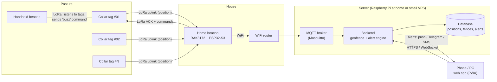
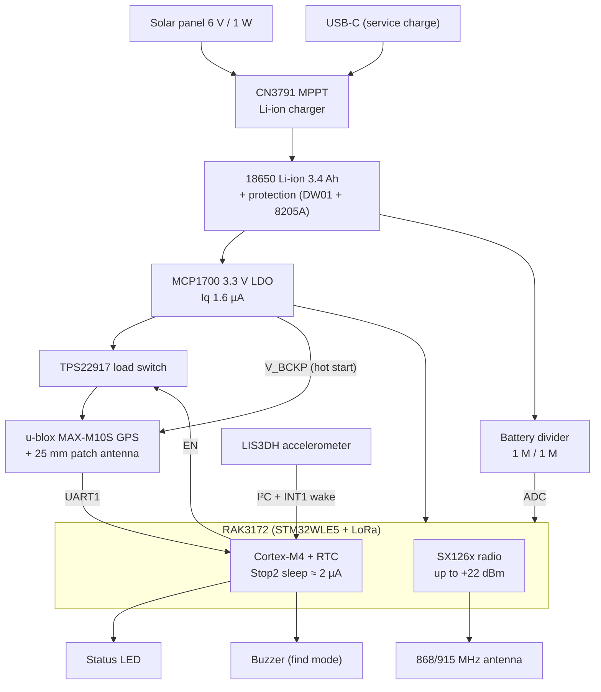
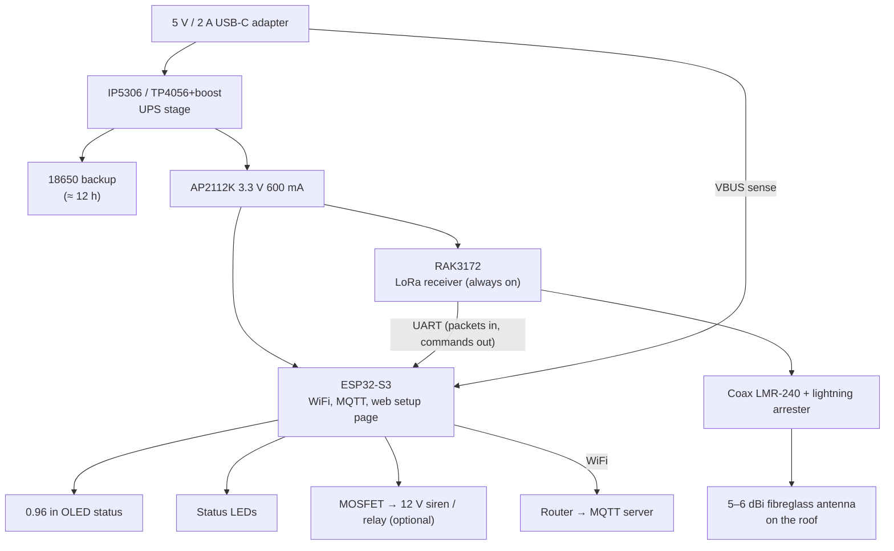
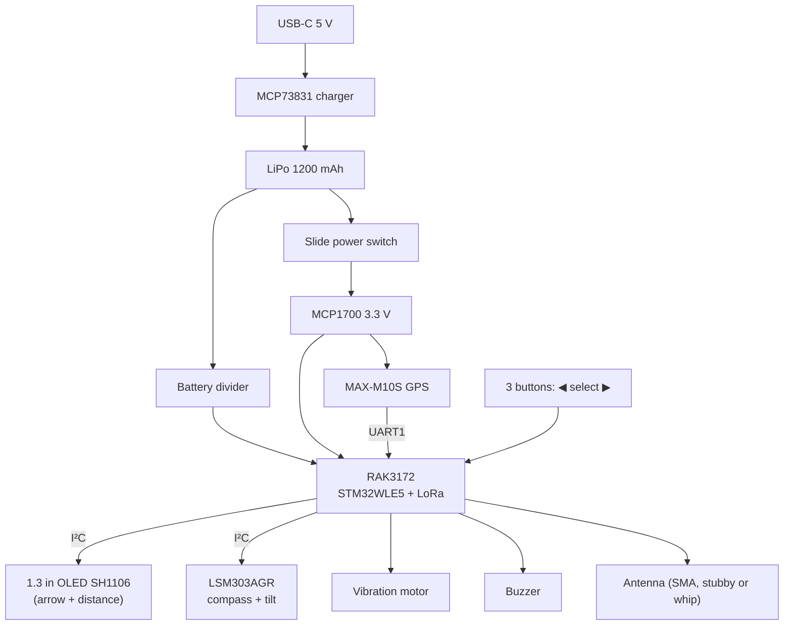
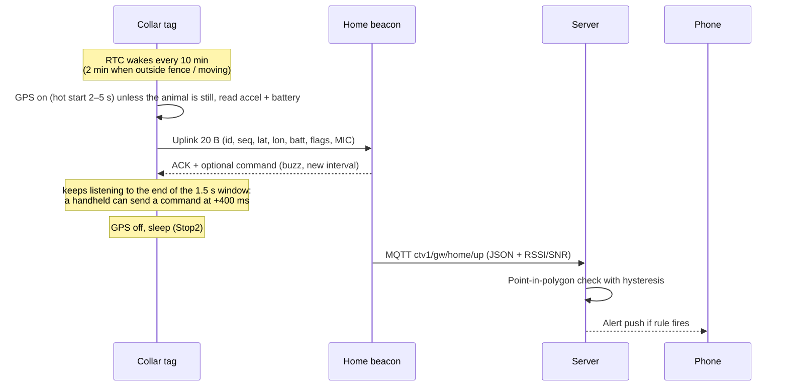

# 01 · System overview (v1)

CTv1 has three devices that all share one radio: a **RAK3172** module, which is an
**STM32WLE5** (Cortex-M4 MCU + Semtech SX126x LoRa radio in one chip). Using the same
module everywhere means one radio driver, one packet format and one firmware codebase.

| Device | Job | Power | Key parts |
|---|---|---|---|
| **Collar tag** (one per animal) | Wake, get a GPS fix, send position over LoRa, sleep | 18650 Li-ion + small solar panel | RAK3172, u-blox MAX-M10S GPS, LIS3DH accelerometer |
| **Home beacon** (gateway, at the house) | Receive every tag, ACK it, push data to the app over WiFi | 5 V mains adapter + 18650 backup | RAK3172 + ESP32-S3 (WiFi), roof antenna |
| **Handheld beacon** (you carry it) | Point you to a chosen animal in the field, trigger its buzzer, works with no phone signal | 1200 mAh LiPo, USB-C | RAK3172, MAX-M10S, LSM303AGR compass, OLED |

## System block diagram

The handheld listens on the same channel as the gateway, so it hears every tag directly.
That is what makes it useful when the internet or the house is out of range.

## Collar tag block diagram

## Home beacon block diagram

## Handheld beacon block diagram

## How a report flows

## Radio settings (v1: LoRa point-to-point, not LoRaWAN)

LoRa P2P is simpler for a single farm: no network server, no join procedure, and the
gateway is one cheap module instead of an 8-channel concentrator.

| Setting | Value | Why |
|---|---|---|
| Band | Choose for your country: **IN865** (865–867 MHz, India), **EU868**, **US915**, **AU915** | Legal ISM band. Buy the module variant for that band. |
| Spreading factor | **SF10** default (set per device with `ATC+CTSF`) | ~5 km on open ground with the roof antenna. SF9 ~2–4 km, SF11 for hills |
| Bandwidth | 125 kHz | Standard |
| Coding rate | 4/5 | Standard |
| TX power | **+20 dBm** default for India (865–867 MHz allows up to 1 W); 14 dBm for EU868 | Costs almost nothing next to the GPS |
| Payload | 20 bytes | Airtime 371 ms at SF10 (186 ms at SF9). ACK 10 bytes: 289 ms |
| Collision handling | Random 0–30 s jitter on each wake, ACK + 1 retry | 5 tags × 6/h ≈ 0.3 % channel use; even 50 tags stay under 4 % |
| Reply timing | Beacon ACK at +50 ms; handheld command after the ACK ends (+439 ms at SF10); tag listens 1.5 s | Worked out per SF by `ctv1_handheld_reply_delay_ms()` / `ctv1_tag_rx_window_ms()` so they never overlap |

### Uplink packet (20 bytes, little-endian)

| Byte | Field | Notes |
|---|---|---|
| 0 | `type` | `0x01` position, `0x02` no fix this time (lat/lon = last known position) |
| 1–2 | `tag_id` | uint16 |
| 3 | `seq` | wraps at 255, used to drop duplicates |
| 4–7 | `lat` | int32, degrees × 1e7 |
| 8–11 | `lon` | int32, degrees × 1e7 |
| 12 | `batt` | (mV − 2000) / 10 → 2.00–4.55 V |
| 13 | `flags` | bit0 fix ok, bit1 moving, bit2 low batt, bit3 solar charging, bit4 outside fence (local check), bit5 last command carried out, bit6 still (GPS skipped because the animal hasn't moved; lat/lon is still current) |
| 14 | `sats_hdop` | high nibble sats (0–15), low nibble HDOP (0–15 ×0.5) |
| 15 | `activity` | accelerometer movement count since last report (0–255) |
| 16–19 | `mic` | first 4 bytes of AES-128-CMAC over bytes 0–15 with the tag key. Tag key = AES(farm key, "CT1" + tag_id), so the home beacon only stores the farm key. |

### Downlink (gateway → tag, sent in a 1 s RX window right after the uplink)

| Byte | Field |
|---|---|
| 0 | `type` `0x81` ACK, `0x82` ACK + command |
| 1–2 | `tag_id` |
| 3 | `seq` being acknowledged |
| 4 | `cmd`: `0x00` none, `0x01` buzz N seconds, `0x02` set interval (minutes), `0x03` fast-track for N hours (0 = stop) |
| 5 | `arg` |
| 6–9 | `mic` (CMAC over bytes 0–5, tag key) |

## Power budget (collar tag)

| State | Current | Time per report | Charge per report |
|---|---|---|---|
| GPS hot start + fix | ~25 mA (MAX-M10S + MCU) | ~5 s typical, 30 s worst | 0.035 – 0.21 mAh |
| LoRa TX +20 dBm, SF10 | ~90 mA | 0.37 s | 0.0093 mAh |
| LoRa RX window | ~5 mA | 1 s | 0.0014 mAh |
| Sleep (MCU Stop2 + LDO + accel + GPS backup) | ~45 µA | rest of interval | 1.1 mAh / day |

At a 10-minute interval (144 reports/day) that is roughly **7–32 mAh/day**, so a
3400 mAh 18650 alone lasts about **3.5 to 12 months**. A 1 W solar panel gives
~150–300 mAh/day in decent sun, so with solar the tag should run indefinitely.
Measure the real number with a current meter (e.g. Nordic PPK2 or a µCurrent) during bring-up.

Next: [02 · Collar tag hardware](02-hardware-collar-tag.md)
