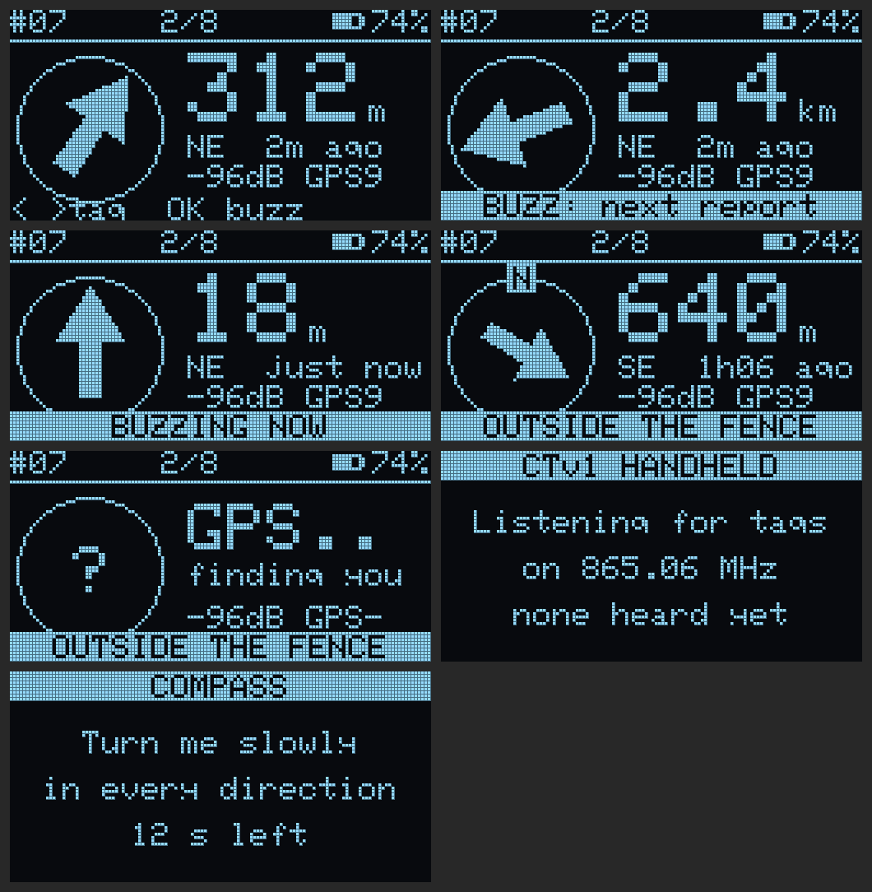

# 04 · Handheld beacon hardware

The handheld finds a chosen animal in the field without a phone or internet. It hears
tag uplinks directly, works out distance and bearing from its own GPS to the tag's last
position, and shows an arrow that turns with you thanks to the compass. It can also send
the "buzz" command so you hear the animal when you are close.

## Screen behaviour

```
 ┌──────────────────────────┐
 │ #07 MOTI        ▮▮▮▯ 74% │   selected tag + its battery
 │                          │
 │            ▲             │   arrow points to the animal
 │           ╱ ╲            │   (bearing − compass heading)
 │          ╱   ╲           │
 │                          │
 │   312 m    NE    2 min   │   distance · direction · age of fix
 │ RSSI -96  SNR 7   ⎈ 9sat │
 └──────────────────────────┘
  [◀ prev]  [● BUZZ / hold=menu]  [next ▶]
```

## Schematic

```
                         POWER
 USB-C receptacle (5.1 kΩ on CC1 and CC2 to GND)
   VBUS ──┬────────────► MCP73831 VIN        PROG ── 2 kΩ → 500 mA charge
          │              STAT ── 1 kΩ ──►|── orange "charging" LED
          │              VBAT ──┬────────── LiPo 1200 mAh (with protection)
         4.7µF                 4.7µF
                                │
                                ├── R 1 MΩ ─┬─ R 1 MΩ ── GND
                                │           └──► BAT_SENSE (PB3) + 100 nF
                                │
                          SPDT slide switch
                                │
                           ┌────┴─────┐
                           │ MCP1700  │ 3V3
                           │ 3.3 V    ├──┬──► 3V3 rail
                           └────┬─────┘ 1µF + 22µF
                               GND

                         MCU + RADIO  (RAK3172)
                    ┌──────────────────────────────────────────┐
     3V3 ───────────┤ VDD                                  RF  ├── u.FL → SMA bulkhead
                    │                                          │   → 868/915 MHz stubby or
   GPS_TX ─────────►│ PB7  UART1_RX                            │     ½-wave whip antenna
   GPS_RX ◄─────────│ PB6  UART1_TX                            │
   GPS_EN ◄─────────│ PA8                                      │
                    │                                          │
   I2C_SDA ◄───────►│ PA11 ─┬─ 4.7 kΩ to 3V3                   │
   I2C_SCL ◄────────│ PA12 ─┘                                  │
                    │                                          │
   BTN_PREV ───────►│ PA0  (wake) ┐                            │
   BTN_OK ─────────►│ PA1        ├ each: button to GND,        │
   BTN_NEXT ───────►│ PB4        ┘ internal pull-up, 100 nF    │
                    │                                          │
   VIB ◄────────────│ PB5   ── 2N7002 driver (as buzzer on tag) │
   BUZZ ◄───────────│ PA10  ── 2N7002 driver                   │
   BAT_SENSE ──────►│ PB3   ADC                                │
                    │ PA2/PA3 UART2 + PA13/PA14 SWD → debug pads│
                    └──────────────────────────────────────────┘

                         I²C BUS (shared)
   1.3" OLED SH1106 128×64  ── addr 0x3C   (VCC 3V3, GND, SDA, SCL)
   LSM303AGR accel + magnetometer ── addr 0x19 / 0x1E  (tilt-compensated compass)

                         GPS
   Same circuit as the collar tag: TPS22917 load switch on PA8, MAX-M10S, patch antenna
   on the top edge of the case facing up when held.

                         HAPTICS
   3V3 ── vibration motor (10 mm coin) ── D 2N7002 ← PB5,  1N4148 across the motor
   3V3 ── magnetic buzzer               ── D 2N7002 ← PA10, 1N4148 across the buzzer
```

## Firmware

`firmware/handheld` (RAK3172, RUI3). Usage, buttons and the rendered screens are in
[firmware/README.md](../firmware/README.md#handheld-beacon).

- Listens to every collar's report on the farm channel, checks each one with the farm key, and keeps
  the last position of up to 32 collars.
- **Buzz / fast-track without the house:** a command chosen on the handheld is sent in the collar's
  own receive window 400 ms after its next report. That is after the home beacon's ACK, so both can
  answer. The collar keeps listening for the whole 1.5 s window for this reason.
- Compass: LSM303AGR, tilt-compensated, with a 20-second hard-iron calibration that is saved in flash.
- The OLED is driven directly (SH1106 or SSD1306), with no display library, to stay small.



## Bill of materials

| Qty | Part | Approx. cost (USD) |
|---|---|---|
| 1 | RAK3172 (IPEX) | 8 |
| 1 | MAX-M10S + patch (or ATGM336H) | 5–15 |
| 1 | LSM303AGR breakout | 4 |
| 1 | 1.3" SH1106 OLED I²C | 3 |
| 1 | MCP73831 + MCP1700 + USB-C receptacle | 2 |
| 1 | LiPo 1200 mAh 103450 | 4 |
| 1 | SMA bulkhead + u.FL pigtail + stubby antenna | 4 |
| 3 | Tactile buttons (IP67 type if possible) | 2 |
| 1 | Vibration motor, buzzer, 2× 2N7002 | 1.5 |
| 1 | Handheld enclosure (≈ 115×65×25 mm) | 5 |
| | **Total** | **≈ 40–50** |

Battery: GPS on continuously (~25 mA) + radio RX (~5 mA) + OLED (~10 mA) ≈ 40 mA → about
**25–30 hours of use**, and weeks in standby with GPS off.

Next: [05 · Expansion options](05-expansion.md)
