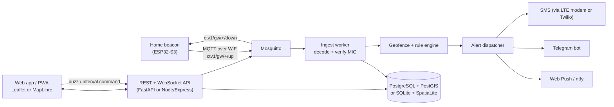

# 06 · DIY app: map, geofence and alerts

A clickable mockup of the UI is in [`app/mockup/index.html`](../app/mockup/index.html)
(open it in any browser; it runs a simulated herd, no server needed).

## Architecture



### Where to run it

| Option | Hardware | Pros | Cons |
|---|---|---|---|
| **A. At home** (recommended for v1) | Raspberry Pi 4/5 or any old PC | No monthly cost, works on local WiFi with no internet | Needs a tunnel (Tailscale / Cloudflare Tunnel) to reach it from outside |
| B. Cloud | Smallest VPS (1 vCPU, 1 GB) | Reachable anywhere, easy push alerts | Small monthly fee, needs internet at the house |
| C. Low-code | Node-RED + its dashboard, or Home Assistant | Fastest to try | Harder to get a good map / fence editor |

## Functional requirements

### Two views: Simple and Advanced
The app opens in **Simple view**, made for elderly family members and anyone who just
wants to glance at the herd. One button in the top corner switches to **Advanced view**
(the full app), and the choice is remembered on that phone.

| | Simple view | Advanced view |
|---|---|---|
| Shows | One status line in plain words, then the map with the animals, their names, and the house. Paddock fences stay visible as context. | Map plus herd list, alerts, fences, devices, trails, handheld |
| Controls | Big **+**, **−** and **Show all** buttons (64 px), pinch and drag | Same zoom plus editing tools |
| Text | Large names; problems written in words on the map ("Moti · outside", "Lily · no signal") and shown in red | Status pills, numbers, signal details |
| Tap an animal | Shows its full route for today and how far it walked | Opens its detail card; its full route is drawn on the map |
| When a critical alert fires | Map zooms out to show every animal, message shown in large text | Alert list + toast |
| Hidden | Everything else: no menus, settings, numbers or editing | — |

Requirements:
- S1. Simple view is the default for a new install; the mode can be locked by the owner (v1.1).
- S2. Touch targets at least 48 px, body text at least 16 px, high contrast in light and dark.
- S3. Markers and labels keep the same on-screen size at every zoom level.
- S4. "Show all" fits all animals and the house on screen.
- S5. Status line above the map, one sentence, colour + icon + words (never colour alone):
  - red "Moti is outside the fence", "6 of 8 cows are safe"
  - amber "Lily has no signal", "last seen 1 h ago. The other 7 are safe."
  - green "All 8 cows are safe", "updated 07:20"
  Tapping it zooms to the animal(s) it names.
- S6. Tapping an animal shows its **full route for today**: a bold line from where it was at midnight,
  a time mark every 2 hours, a "Start" marker, and a card with "Walked 2.4 km since 00:10" and
  "Last seen 4 min ago". **Show all cows** closes it.
- S7. Touch: pinch to zoom, drag with one finger to pan, double-tap to zoom in. The **+ / − / Show all**
  buttons do the same for people who find gestures hard.

### Map
- F1. Live map of all animals with a marker per tag (tag number + name), updating within
  5 s of the gateway receiving a packet (WebSocket).
- F2. Base layers: street (OpenStreetMap) and satellite (e.g. Esri World Imagery). Offline
  tile cache for poor signal.
- F3. Show the home beacon and the handheld beacon positions.
- F4. Marker state by colour and shape: inside fence, outside fence, stale (no update),
  low battery.
- F5. Tap an animal: last fix time, coordinates, battery %, RSSI/SNR, satellites, speed,
  distance from the house.
- F6. Trail / history playback for a chosen animal and time range (last 2 h, 24 h, 7 days).

### Geofences
- G1. Draw, edit (drag vertices) and delete polygon and circle fences on the map.
- G2. Fence types: **keep-in** (paddock) and **keep-out** (crops, road, river, neighbour).
- G3. Assign fences to all animals or to a group.
- G4. Show area (hectares / acres) and perimeter.
- G5. Schedule a fence (e.g. night paddock 19:00–06:00) for rotation.
- G6. Optionally push the fence to tags so they switch to fast reporting on their own.

### Alerts
| Rule | Default | Severity |
|---|---|---|
| Left a keep-in fence | 2 consecutive fixes outside, or 1 fix > 25 m outside | Critical |
| Entered a keep-out zone | same hysteresis | Critical |
| No update from a tag | > 30 min (3 missed reports) | Warning |
| Battery low | < 20 % (≈ 3.5 V) | Warning |
| No movement | activity count ≈ 0 for > 4 h in daytime | Warning (possible sickness / stuck) |
| Night movement | herd moves > 200 m between 22:00–05:00 | Critical (possible theft / predator) |
| Home beacon offline | no status for 3 min | Critical |

- A1. Each rule can be turned on/off and its threshold changed.
- A2. Channels per user: in-app, push, Telegram, SMS. Critical alerts repeat every 10 min
  until acknowledged.
- A3. Acknowledge and resolve alerts, with who/when.
- A4. Quiet hours for warning-level alerts.

### Commands
- C1. "Find" button: sends buzz command; queued until the tag's next uplink (up to 10 min
  in normal mode, show this delay to the user).
- C2. "Track faster": set a tag to 2-minute reports for N hours.

### Herd and devices
- H1. Animal records: tag ID, name, breed, sex, birth date, photo, group.
- H2. Device list: firmware version, battery trend, last seen, packet loss %.
- H3. Gateway status: online, uptime, WiFi signal, backup battery, packets per hour.

## Non-functional requirements

- Works on a cheap Android phone over a slow 3G/4G link (first load < 300 kB of app code,
  tiles cached).
- Installable as a PWA, usable in direct sunlight (high contrast mode).
- Positions kept 1 year at full resolution, then downsampled.
- Security: MQTT over TLS with username/password per gateway; per-tag AES key for the
  packet MIC; app login with strong password; HTTPS only.
- Survives a server restart without losing packets (gateway buffers, ingest is idempotent
  using `tag_id + seq + day`).

## Data model

```
animals    (id, tag_id, name, breed, sex, born, group_id, photo_url)
devices    (tag_id, kind[collar|gateway|handheld], fw_version, aes_key, interval_s)
positions  (id, tag_id, ts, geom POINT, batt_mv, sats, hdop, activity, rssi, snr, gw_id, seq)
fences     (id, name, kind[keep_in|keep_out], geom POLYGON, group_id, schedule)
fence_state(tag_id, fence_id, inside bool, consecutive int, since ts)
alerts     (id, rule, tag_id, fence_id, severity, ts, message, acked_by, acked_at)
rules      (id, rule, enabled, params jsonb)
users      (id, name, role, telegram_chat_id, phone, push_subscription)
```

## MQTT topics

All topics live under `ctv1/gw/<gw>/`, where `<gw>` is the beacon name set on its settings page
(default `home`). The beacon decodes packets before publishing, so the server does not need the farm key.

| Topic | Direction | Retained | Payload |
|---|---|---|---|
| `up` | beacon → server | no | `{"gw":"home","tag":7,"seq":201,"type":"position","lat":10.8512345,"lon":76.2712345,"batt_mv":3910,"batt_pct":68,"flags":["fix","moving"],"sats":9,"hdop":1.5,"activity":42,"rssi":-97,"snr":7,"ts":1792600000,"raw":"0107..."}` |
| `status` | beacon → server | yes | every 60 s: `{"fw","uptime_s","wifi_rssi","ip","mains","radio_online","radio_reports","radio_rejected","radio_resets","commands_queued","buffered","dropped","tags_heard","fence_corners","alarm","ts"}` |
| `online` | beacon → server | yes | `true`, or `false` from the MQTT last will when the beacon drops off |
| `event` | beacon → server | no | `{"type":"left_fence","tag":7,"fence":"Main paddock","distance_m":31,"source":"beacon"}`. Other types: `returned`, `cmd_queued`, `cmd_done`, `power_lost`, `power_restored`, `radio_reset`, `radio_error`, `fence_updated`, `fence_invalid`, `bad_command`, `beacon_started` |
| `down` | server → beacon | no | `{"tag":7,"cmd":"buzz","arg":30}`. `cmd` is `buzz` (seconds), `interval` (minutes), `fast` (hours, 0 = stop) or `none` |
| `fence` | server → beacon | **yes** | `{"name":"Main paddock","points":[[10.85162,76.26634],[10.8518,76.27082],...]}`, 3–32 corners. Gives the beacon its backup fence check. |

`ts` is Unix time from NTP. Reports buffered while the server was down keep the time they were
received. `ts` is `null` only if the beacon has never had internet since it was switched on.

## Geofence check (server side)

```python
def check(tag, fix, fence, state, margin_m=25):
    inside = point_in_polygon(fix.lon, fix.lat, fence.polygon)   # ray casting / PostGIS ST_Contains
    dist   = distance_to_edge_m(fix, fence.polygon)
    if inside == state.inside:
        state.consecutive = 0
        return None
    state.consecutive += 1
    # GPS jitter near the fence line is normal: need 2 fixes in a row, or one far outside
    if state.consecutive >= 2 or (not inside and dist > margin_m):
        state.inside, state.consecutive = inside, 0
        return Alert("left" if not inside else "returned", tag, fence)
```

## Suggested stack and skills

| Part | Choice | Learn |
|---|---|---|
| Map | Leaflet + Leaflet-Geoman (draw/edit fences) | JS basics |
| Front end | Plain JS or Svelte / React, as a PWA | HTML/CSS/JS |
| Backend | Python FastAPI (or Node-RED for a first try) | Python, REST, WebSocket |
| Broker | Mosquitto | MQTT |
| DB | PostgreSQL + PostGIS (SQLite for very small setups) | SQL, geo queries |
| Alerts | Telegram bot (free, easiest), ntfy, Web Push | Bot API |
| Hosting | Raspberry Pi + Docker Compose + Tailscale | Linux, Docker |

## Build order

1. Tag sends a fixed fake position; gateway prints it on serial.
2. Gateway publishes to MQTT; `mosquitto_sub` shows it.
3. Ingest writes positions to the database.
4. Web map shows the latest point per tag.
5. Fence drawing + point-in-polygon + Telegram alert.
6. Commands (buzz), history, battery and stale alerts.
7. Real GPS on the tag, power optimisation, enclosure, field test with one animal.
