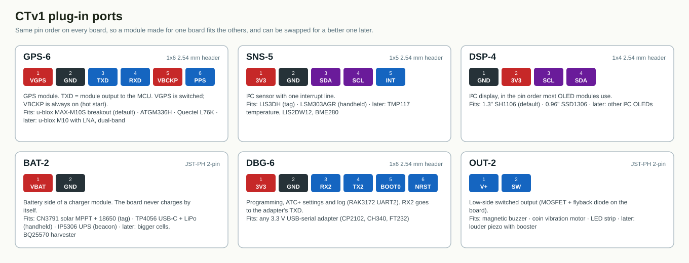
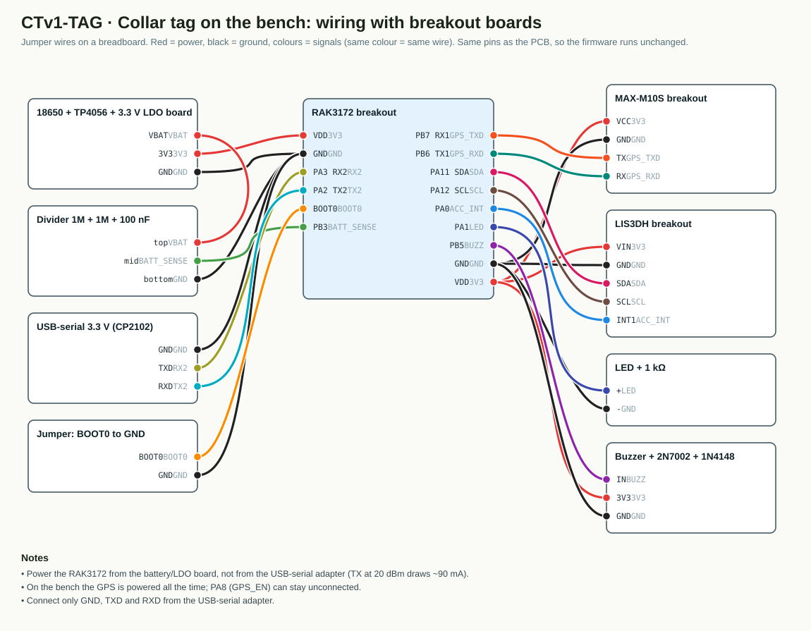
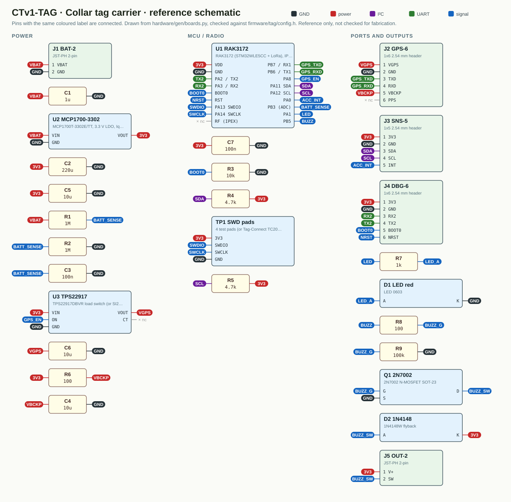
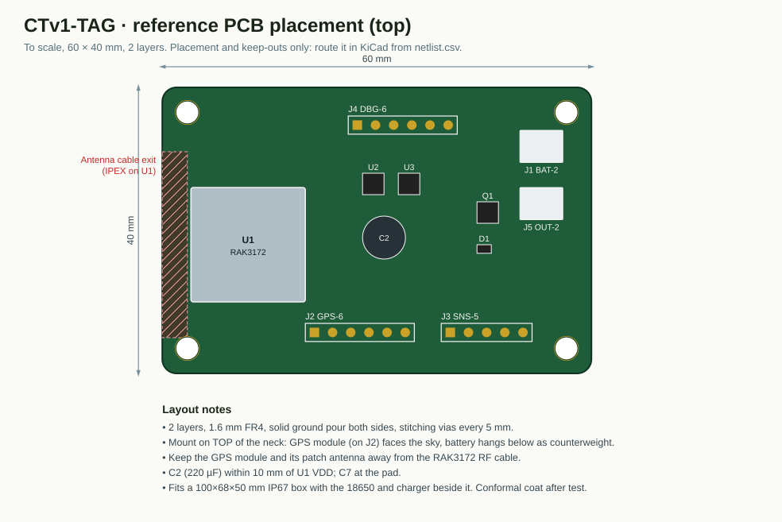
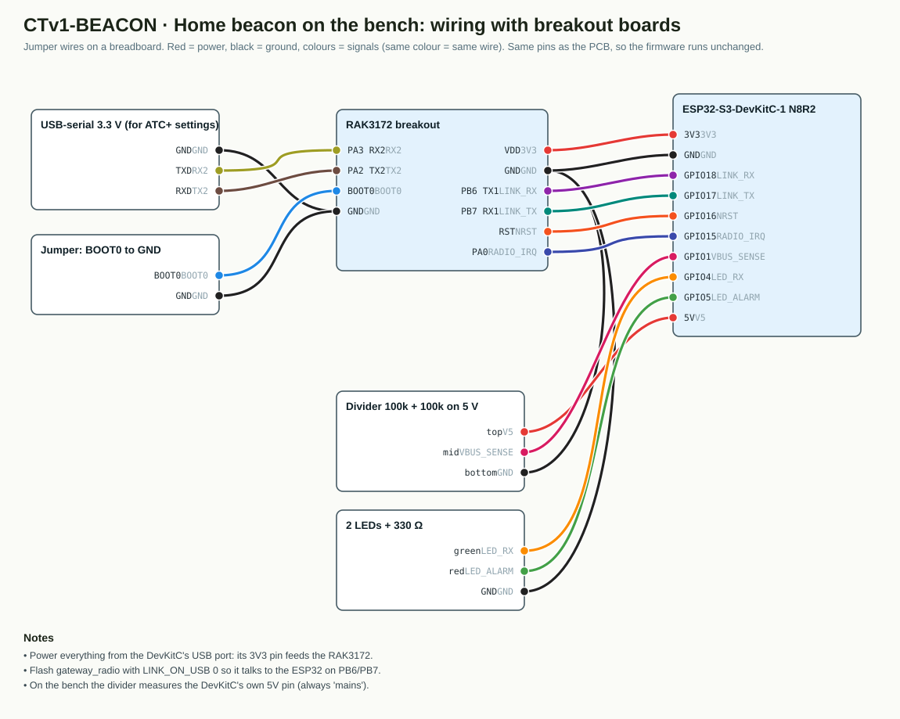
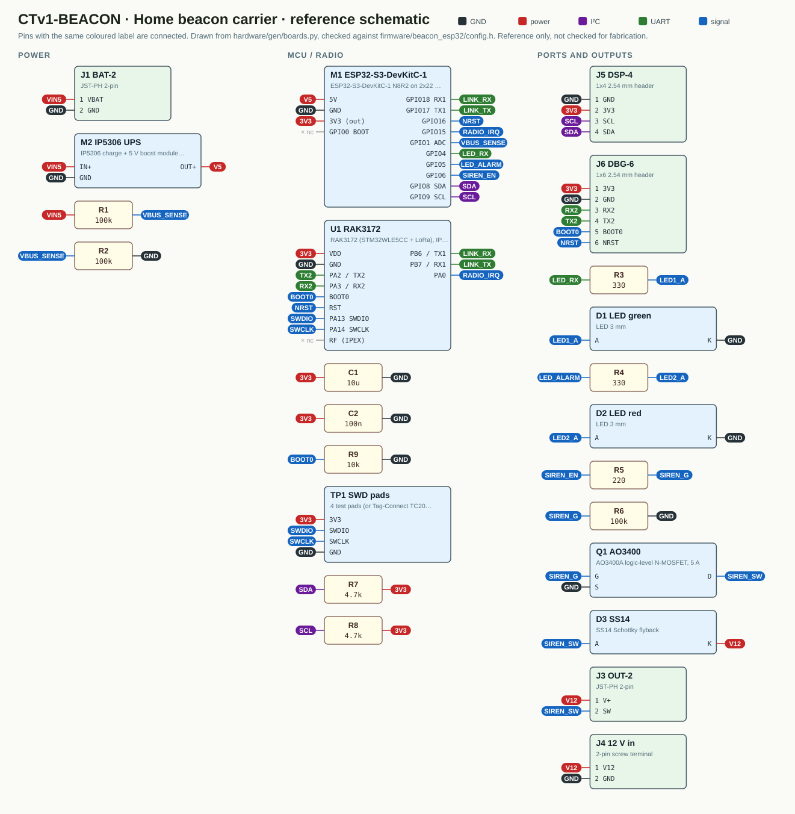
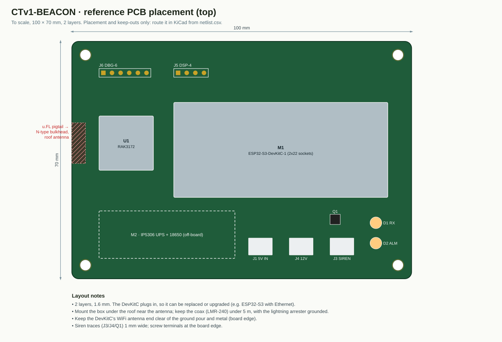
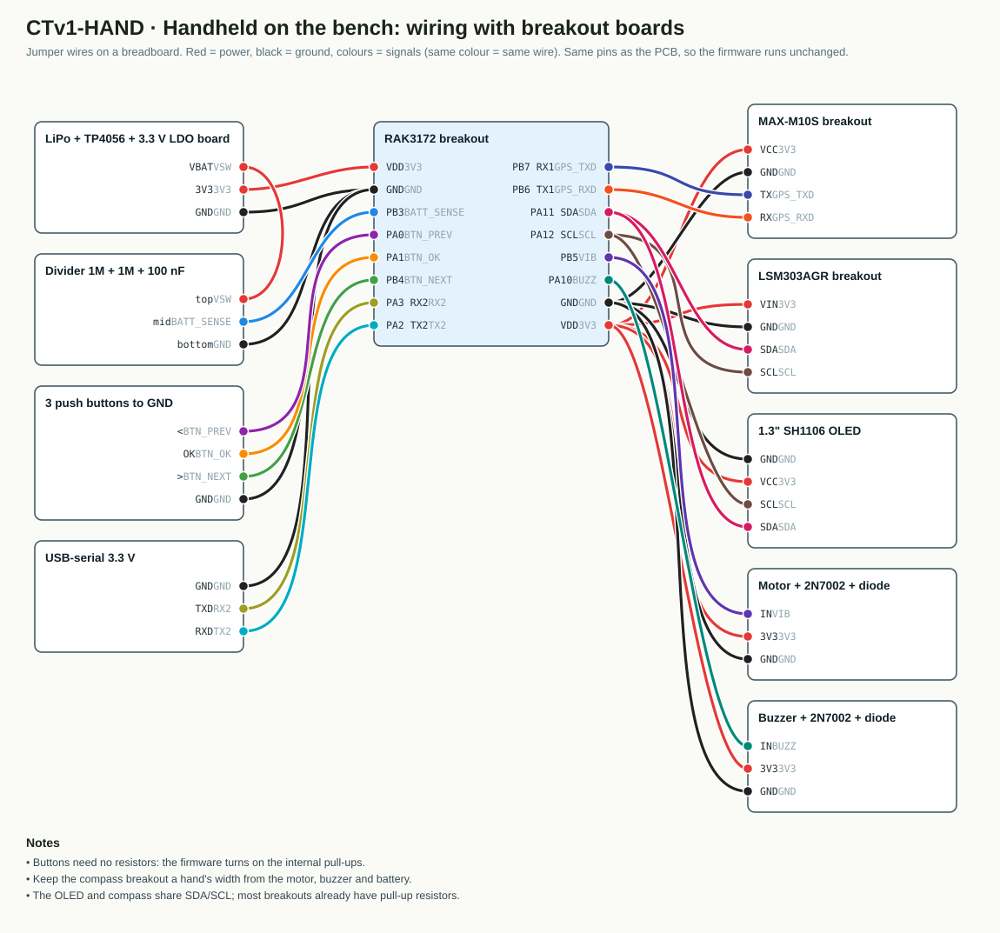
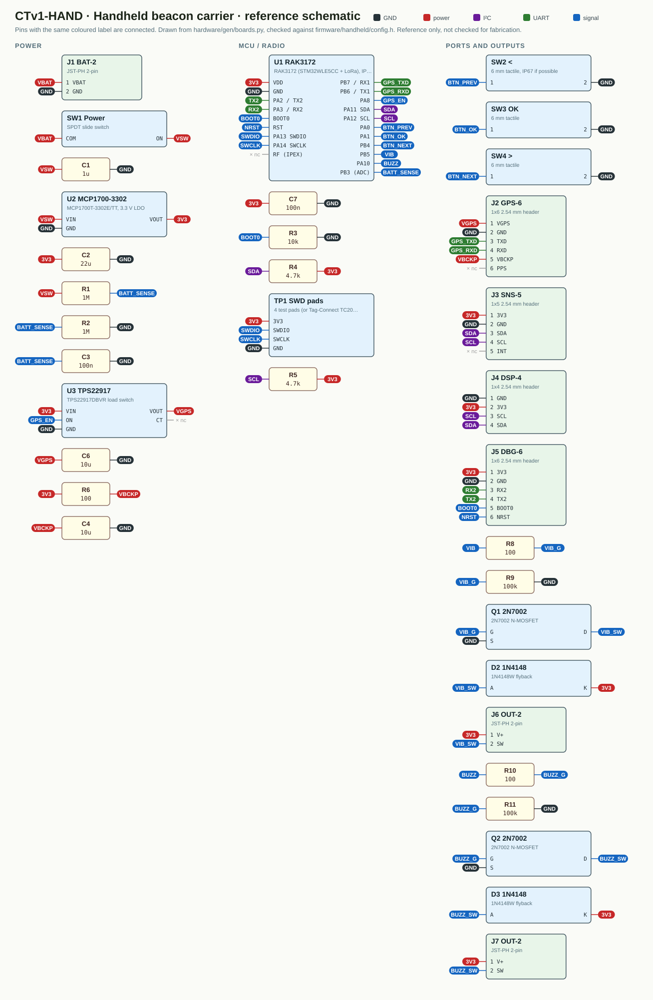
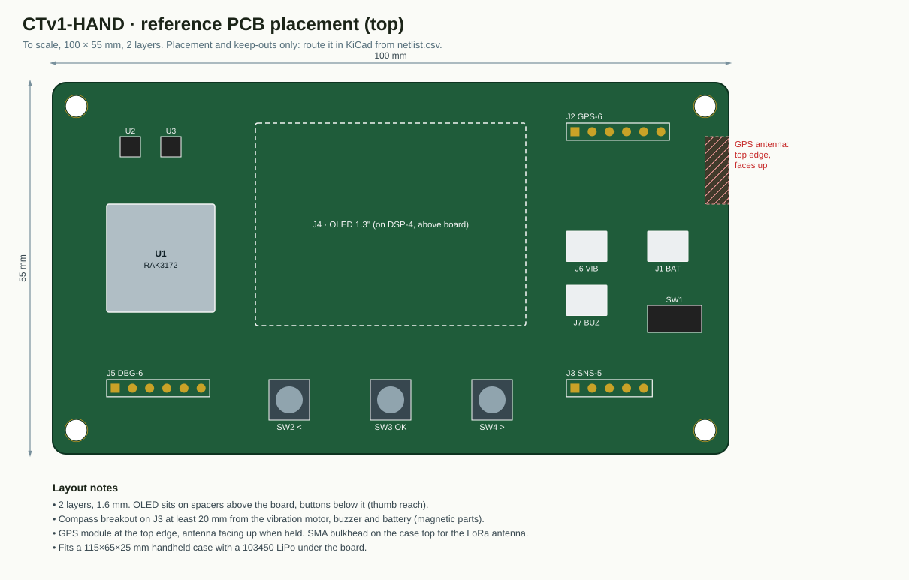

# CTv1 hardware reference

Reference wiring diagrams, schematics and PCB placements for the three CTv1 devices. **Generated** by
`python3 hardware/gen/render.py` from one description per board (`hardware/gen/boards.py`), which also
checks every net and every pin the firmware uses. Change the board file, run the script, commit the
result. Nothing here is checked for fabrication yet: these are the starting point for KiCad (task T-040).

## Modular build

Each device is a **carrier board** with the RAK3172 and a few small parts. Everything that may change
with budget or client needs plugs into a **standard port**: GPS, sensors, display, charger/battery,
outputs. A cheaper or better module can be swapped in without a new board.

| Port | Connector | Pins | Fits |
|---|---|---|---|
| **GPS-6** | 1x6 2.54 mm header | 1 VGPS · 2 GND · 3 TXD · 4 RXD · 5 VBCKP · 6 PPS | u-blox MAX-M10S breakout (default) · ATGM336H · Quectel L76K · later: u-blox M10 with LNA, dual-band |
| **SNS-5** | 1x5 2.54 mm header | 1 3V3 · 2 GND · 3 SDA · 4 SCL · 5 INT | LIS3DH (tag) · LSM303AGR (handheld) · later: TMP117 temperature, LIS2DW12, BME280 |
| **DSP-4** | 1x4 2.54 mm header | 1 GND · 2 3V3 · 3 SCL · 4 SDA | 1.3" SH1106 (default) · 0.96" SSD1306 · later: other I²C OLEDs |
| **BAT-2** | JST-PH 2-pin | 1 VBAT · 2 GND | CN3791 solar MPPT + 18650 (tag) · TP4056 USB-C + LiPo (handheld) · IP5306 UPS (beacon) · later: bigger cells, BQ25570 harvester |
| **DBG-6** | 1x6 2.54 mm header | 1 3V3 · 2 GND · 3 RX2 · 4 TX2 · 5 BOOT0 · 6 NRST | any 3.3 V USB-serial adapter (CP2102, CH340, FT232) |
| **OUT-2** | JST-PH 2-pin | 1 V+ · 2 SW | magnetic buzzer · coin vibration motor · LED strip · later: louder piezo with booster |

## CTv1-TAG: collar tag carrier

Board 60 × 40 mm. Firmware pins checked against `firmware/tag/config.h`.

| Slot | Default module | How it connects | Upgrade options |
|---|---|---|---|
| U1 | RAK3172 (IN865) | on the board | same footprint: RAK3172-SiP, RAK3172LP |
| J1 | CN3791 MPPT module + 18650 3.4 Ah + 6 V 1 W panel | plugs into BAT-2 | bigger panel/cell; BQ25570 harvester |
| J2 | u-blox MAX-M10S breakout | plugs into GPS-6 | ATGM336H (cheaper), L76K |
| J3 | LIS3DH breakout | plugs into SNS-5 | LIS2DW12 (lower power), + TMP117 on the same bus |
| J5 | 3 V magnetic buzzer | plugs into OUT-2 | louder piezo, vibration |

**Bench wiring** (breakout boards, before the PCB):

**Reference schematic**:

**PCB placement**:

Files: [netlist.csv](tag/netlist.csv) · [bom.csv](tag/bom.csv)

## CTv1-BEACON: home beacon carrier

Board 100 × 70 mm. Firmware pins checked against `firmware/beacon_esp32/config.h`.

| Slot | Default module | How it connects | Upgrade options |
|---|---|---|---|
| U1 | RAK3172 (IN865) | on the board | Heltec V3 instead of U1 + M1 for quick tests |
| M1 | ESP32-S3-DevKitC-1 N8R2 | 2x22 sockets | ESP32-S3 + W5500 Ethernet; + A7670 LTE on a spare UART |
| M2 | IP5306 UPS module + 18650 | wired to J1 / V5 | bigger cell, 12 V UPS |
| J3 | 12 V siren / relay | plugs into OUT-2 | floodlight relay |
| J5 | 0.96" SSD1306 OLED | plugs into DSP-4 | 1.3" SH1106 |

**Bench wiring** (breakout boards, before the PCB):

**Reference schematic**:

**PCB placement**:

Files: [netlist.csv](beacon/netlist.csv) · [bom.csv](beacon/bom.csv)

## CTv1-HAND: handheld beacon carrier

Board 100 × 55 mm. Firmware pins checked against `firmware/handheld/config.h`.

| Slot | Default module | How it connects | Upgrade options |
|---|---|---|---|
| U1 | RAK3172 (IN865) | on the board | same footprint: RAK3172-SiP |
| J1 | TP4056 USB-C module (with protection) + LiPo 1200 mAh | plugs into BAT-2 | bigger LiPo |
| J2 | u-blox MAX-M10S breakout | plugs into GPS-6 | ATGM336H, L76K |
| J3 | LSM303AGR breakout | plugs into SNS-5 | LIS2MDL + LSM6DSO (better compass) |
| J4 | 1.3" SH1106 OLED | plugs into DSP-4 | 0.96" SSD1306 (set OLED_SH1106 0) |
| J6/J7 | coin vibration motor / buzzer | plug into OUT-2 | louder buzzer |

**Bench wiring** (breakout boards, before the PCB):

**Reference schematic**:

**PCB placement**:

Files: [netlist.csv](handheld/netlist.csv) · [bom.csv](handheld/bom.csv)

## From here to a real PCB

1. Bench-test with breakouts using the wiring diagrams (tasks T-025 to T-028).
2. Draw the schematic in KiCad from `netlist.csv`; the RAK3172 footprint comes from RAK's KiCad library.
3. Place parts as in `pcb.svg`, keep the marked RF / GPS zones, pour ground on both layers.
4. Run KiCad's electrical and design rule checks, then order 5 boards from any 2-layer PCB service.
